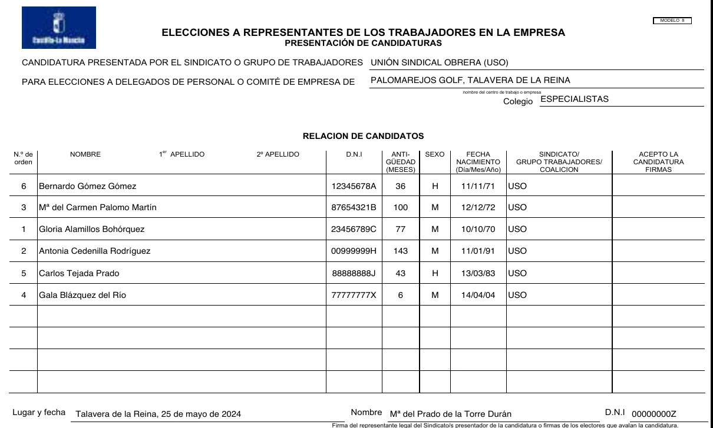
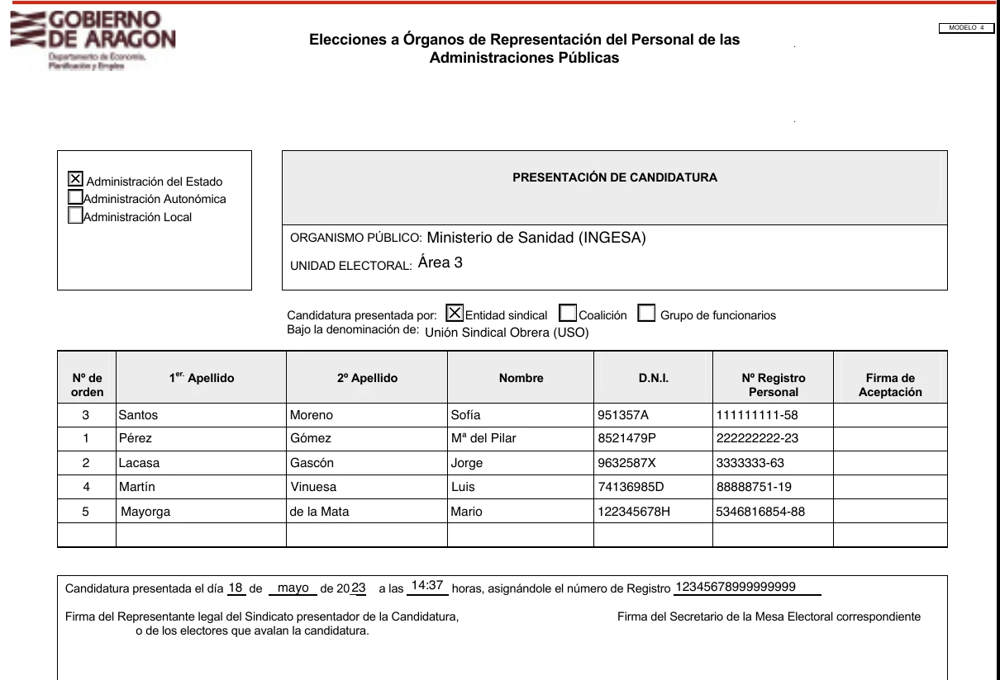
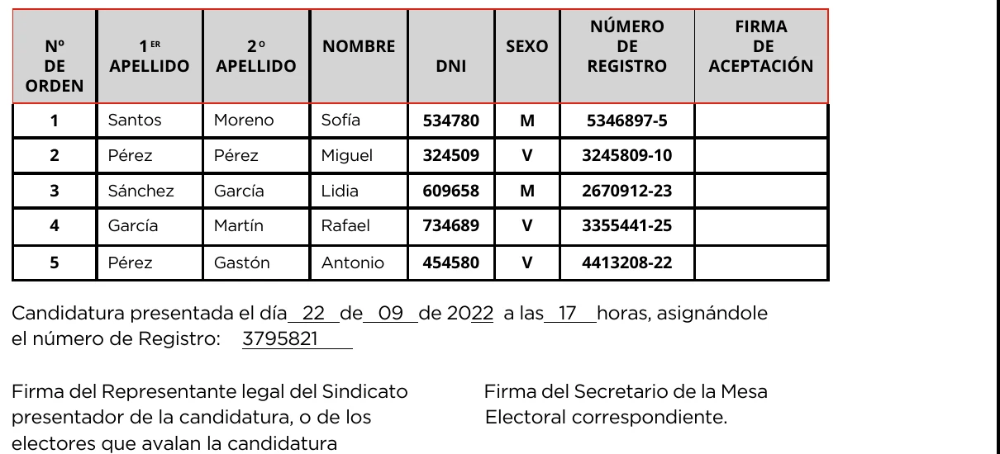

# 13. CANDIDATURAS ELECTORALES

## 13.1. LEGITIMACIÓN PARA PRESENTAR CANDIDATURAS

Están legitimados para presentar candidatos, candidatas y candidaturas para las elecciones de delegados de personal, miembros del comité de empresa y juntas de personal:

a) Los sindicatos legalmente constituidos.

b) Las personas trabajadoras o grupos de funcionarios y funcionarias que avalen su candidatura con un número de firmas de electores de su mismo centro y colegio, en su caso, equivalente al menos a tres veces el número de puestos a cubrir.

c) Las coaliciones formadas por dos o más sindicatos. Deberán tener una denominación concreta, y los resultados obtenidos serán otorgados exclusivamente a tal coalición.

**(Art. 69-3 E.T.)**

**(Art. 26.4 de la Ley 9/87, Modificado por Ley 18/94)**

## 13.2. CANDIDATURAS PARA DELEGADOS Y DELEGADAS DE PERSONAL (LISTAS ABIERTAS)

Se presentarán por cada candidatura tantas personas candidatas como puestos a cubrir; no obstante, cuando el número de candidatos y candidatas para delegados y delegadas de personal sea inferior al de puestos a elegir, se celebrará la elección para la cobertura de los puestos correspondientes a los candidatos presentados, quedando vacantes el resto de puestos. **(Art. 8.2 R.D. 1844/94) (Art. 16.2 del R.D. 1846/94)**

::: importante
En empresas o centros de trabajo que tengan entre 6 y 49 personas trabajadoras, solamente presentaremos tantos candidatos y candidatas como puestos a cubrir, para evitar la dispersión de votos.

:::

## 13.3. CANDIDATURAS PARA COMITÉS DE EMPRESA Y JUNTAS DE PERSONAL (LISTAS CERRADAS)

En empresas, centros de trabajo o unidades electorales de la Administración Pública a partir de 50 o más personas trabajadoras las candidaturas **deberán contener, como mínimo, tantos nombres como puestos a cubrir.**

No obstante, la renuncia de cualquier persona candidata presentada en alguna de las listas para las elecciones una vez proclamada de forma definitiva y antes de la fecha de votación, no implicará la suspensión del proceso electoral, ni la anulación de la candidatura aún cuando ésta sea incompleta, siempre y cuando la candidatura presentada permanezca con un número de candidatos de, al menos, el 60 %, del total de los puestos a cubrir.

**(Art. 71.2.a) E.T.) (Art. 8.3 R.D. 1844/94)**

**(Art. 18 Ley 9/87, Modificado por la Ley 18/94) (Art. 16.3 del R.D.1846/94)**

::: importante
A fin de evitar problemas, se recomienda presentar las candidaturas a la mesa electoral, solamente a escasos minutos de la finalización del plazo para su presentación fijado en el calendario electoral elaborado por la mesa. Al presentar la candidatura, hay que llevar original y copia para que el presidente o presidenta de la mesa certifique, firmando y poniendo la fecha y la hora, la entrega de la candidatura dentro del plazo establecido.

Las candidaturas deben ir siempre firmadas obligatoriamente por un representante legal del sindicato con poder notarial.

No se aceptarán candidaturas que estén completadas con firma electrónica, ya que la legislación vigente en materia de elecciones sindicales no contempla esa opción.

:::

Ver el texto de los modelos (versión accesible)

**ELECCIONES A REPRESENTANTES DE LOS TRABAJADORES EN LA EMPRESA**

**PRESENTACIÓN DE CANDIDATURAS**

CANDIDATURA PRESENTADA POR EL SINDICATO O GRUPO DE TRABAJADORES UNIÓN SINDICAL OBRERA (USO)

PARA ELECCIONES A DELEGADOS DE PERSONAL O COMITÉ DE EMPRESA DE PALOMAREJOS GOLF, TALAVERA DE LA REINA

nombre del centro de trabajo o empresa

Colegio ESPECIALISTAS

**RELACION DE CANDIDATOS**

N.º de NOMBRE 1 er APELLIDO 2º APELLIDO D.N.I ANTI- SEXO FECHA SINDICATO/ orden GÜEDAD NACIMIENTO GRUPO TRABAJADORES/

(MESES) (Día/Mes/Año) COALICION

6 Bernardo Gómez Gómez 12345678A 36 H 11/11/71 USO

3 Mª del Carmen Palomo Martín 87654321B 100 M 12/12/72 USO

1 Gloria Alamillos Bohórquez 23456789C 77 M 10/10/70 USO

2 Antonia Cedenilla Rodríguez 00999999H 143 M 11/01/91 USO

5 Carlos Tejada Prado 88888888J 43 H 13/03/83 USO

4 Gala Blázquez del Río 77777777X 6 M 14/04/04 USO

Lugar y fecha Talavera de la Reina, 25 de mayo de 2024 Nombre Mª del Prado de la Torre Durán D.N.I

Firma del representante legal del Sindicato/s presentador de la candidatura o firmas de los electores que avalan

**Elecciones a Órganos de Representación del Personal de las**

**Administraciones Públicas**

Administración del Estado **PRESENTACIÓN DE CANDIDATURA** Administración Autonómica Administración Local

ORGANISMOPÚBLICO: Ministerio de Sanidad (INGESA)

UNIDAD ELECTORAL: Área 3

Candidatura presentada por: Entidad sindical Coalición Grupo de funcionarios Bajo la denominación de: Unión Sindical Obrera (USO)

**Nº de 1 er. Apellido 2º Apellido Nombre D.N.I. Nº Registro Firma orden Personal Aceptación**

3 Santos Moreno Sofía 951357A 111111111-58

1 Pérez Gómez Mª del Pilar 8521479P 222222222-23

2 Lacasa Gascón Jorge 9632587X 3333333-63

4 Martín Vinuesa Luis 74136985D 88888751-19

5 Mayorga de la Mata Mario 122345678H 5346816854-88

Candidatura presentada el día 18 de mayo de 20_ 23 a las 14:37 horas, asignándole el número de Registro 12345678999999999

Firma del Representante legal del Sindicato presentador de la Candidatura, Firma del Secretario de la Mesa Electoral correspondiente

ode los electores que avalan la candidatura.

**NÚMERO FIRMA Nº 1 ER 2 O NOMBRE SEXO DE DE DE APELLIDO APELLIDO DNI REGISTRO ACEPTACIÓN ORDEN**

**1** Santos Moreno Sofía **534780 M 5346897-5**

**2** Pérez Pérez Miguel **324509 V 3245809-10**

**3** Sánchez García Lidia **609658 M 2670912-23**

**4** García Martín Rafael **734689 V 3355441-25**

**5** Pérez Gastón Antonio **454580 V 4413208-22**

Candidatura presentada el día 22 de 09 de 2022 a las 17 horas, asignándole el número de Registro: 3795821

Firma del Representante legal del Sindicato Firma del Secretario de la Mesa presentador de la candidatura, o de los Electoral correspondiente. electores que avalan la candidatura

**(Modelo 4 de la Orden de 16 de julio de 1998, por la que se publican los modelos normalizados de impresos, sobres y papeletas de votación a utilizar en las elecciones a órganos de representación del personal al servicio de las Administración General del Estado)**

**Nota:** Se rellenarán y adjuntarán, tantas páginas modelo como sean necesarias.

## 13.4. LA PRESENTACIÓN DE LAS CANDIDATURAS

Se efectuará ante la mesa electoral correspondiente, dentro de las fechas marcadas en el calendario electoral para tal fin y serán expuestas en los tablones de anuncios de la empresa, centro de trabajo o unidad electoral.

Las candidaturas serán presentadas, obligatoriamente, en los impresos oficiales creados al efecto, y deberán ir debidamente firmadas por cada uno de los candidatos y candidatas, como conformidad a su aceptación a figurar como persona candidata.

**(Art. 74.3 E.T.)**

**(Art. 8.1 R.D. 1844/94)**

**(Art. 26.4 de la Ley 9/87, Modificado por Ley 18/94)**

**(Art. 16.1 del R.D. 1846/94)**

## 13.5. CANDIDATURAS PRESENTADAS POR GRUPOS DE TRABAJADORES O FUNCIONARIOS

En los casos de candidaturas (a delegados y delegadas de personal o miembros del comité de empresa o juntas de personal), presentadas por grupos de trabajadores o funcionarios, se deberán adjuntar los datos de identificación y las firmas correspondientes que avalan la candidatura, que deberán ser, al menos el triple de los miembros a elegir.

**(Art. 8.1 R.D. 1844/94)**

**(Art. 17.2 de la Ley 9/87, Modificado por Ley 18/94)**

**(Art. 16.1 del R.D. 1846/94)**

## 13.6. CANDIDATURAS DE SOCIOS-TRABAJADORES (COOPERATIVAS)

En las sociedades cooperativas solamente pueden participar en el proceso electoral los que sean personas trabajadoras asalaridas no socias de la entidad.

“Al tratarse de una actividad empresarial cuya titularidad jurídica corresponde a una sociedad cooperativa, sólo los trabajadores asalariados o los trabajadores en los que no concurra la cualidad de socio-cooperativista (accionariado de la empresa), están legitimados para ser electores y/o elegibles, sin que tales aptitudes puedan asignarse a los trabajadores que ostenten la condición de participantes sociales en la entidad cooperativa”.

**(Sentencia Magistratura de Trabajo, nº 2 de Gijón, de 30 de Octubre de 1986)**

**(Disposición Adicional Primera R.D. 1844/94)**

## 13.7. DENOMINACIÓN DE LAS CANDIDATURAS

**Es de obligado cumplimiento para todas las organizaciones territoriales, federales, sectoriales y secciones sindicales, que la denominación de candidatos y candidatas (delegados y delegadas de personal) o candidaturas (comités de empresa y juntas de personal) se realice exclusivamente bajo la denominación UNIÓN SINDICAL OBRERA (USO).**

En los casos de convergencia electoral con otros sindicatos, la denominación electoral será la que oportunamente acuerden los órganos de decisión del sindicato, en función a los contenidos de los protocolos de convergencia electoral firmados.

## 13.8. LA ELABORACIÓN DE LAS CANDIDATURAS

Es responsabilidad, en primera instancia, de las secciones sindicales constituidas, la elaboración de las candidaturas así como la distribución del orden de los puestos a cubrir (listas cerradas) en su ámbito de empresa, centro de trabajo o unidad electoral; candidaturas que, en todo caso, deberán ser ratificadas y firmadas por su federación territorial constituida, o, en su defecto, por la unión territorial.

Donde no haya sección sindical constituida, la confección de las candidaturas corre a cargo de los afiliados a la empresa junto con los responsables federales o uniones territoriales.

**(Art. 8.2 R.D. 1844/94) (Art. 16.2 del R.D. 1846/94)**

::: importante
Las candidaturas, obligatoriamente deberán ir firmadas por un representante legal del sindicato con poder notarial de firma a efectos electorales sindicales.

:::

::: comentario
Es importante que el cierre de candidaturas se realice lo antes posible, ello permitiría una mayor dedicación a abrir nuevos espacios electorales y, por consiguiente, la posibilidad cierta de conseguir una mayor representatividad.

:::

## 13.9. PROCLAMACIÓN DE CANDIDATURAS

### DELEGADOS Y DELEGADAS DE PERSONAL:

La proclamación de candidaturas será realizada por la mesa electoral atendiendo a los plazos que esta haya marcado con criterios de razonabilidad y según lo aconsejen las circunstancias. En todo caso se efectuará dentro de los **10 días** que como máximo deben existir **entre la constitución de la Mesa y la fecha de elecciones.**

**(Art.74.2 E.T.)**

### COMITÉS DE EMPRESA Y JUNTAS DE PERSONAL:

Las candidaturas se presentarán dentro de los 9 días siguientes a la publicación de la lista definitiva de electores. En los 2 días laborables siguientes, la mesa proclamará las candidaturas procediendo a su publicación en el tablón de anuncios.

Contra la proclamación se podrá reclamar dentro del día laborable siguiente y la mesa resolverá en el posterior día hábil.

Entre la proclamación y la votación deben mediar, al menos, 5 días.

**(Art. 74.3 E.T.)**

**(Art. 16.4 del R.D. 1846/94)**
