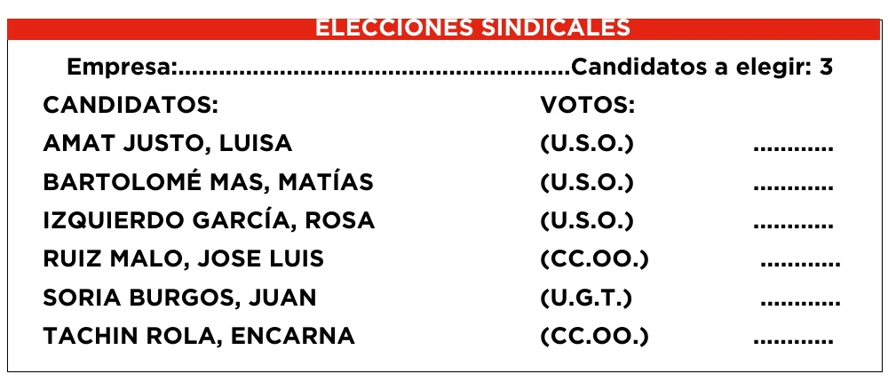
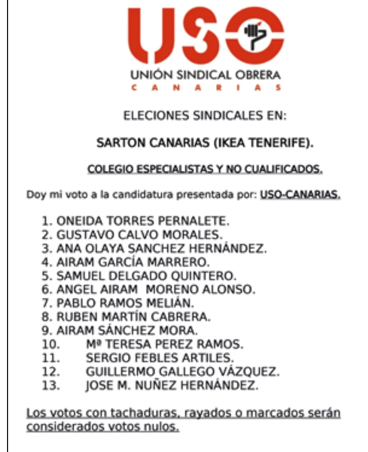
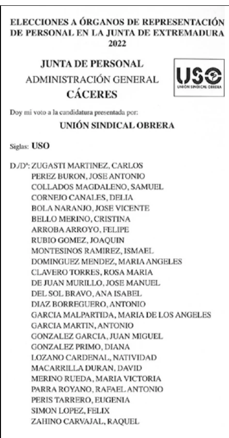

# 16. PAPELETAS ELECTORALES (DETERMINACIÓN DE PUESTOS)

## 16.1. EN LISTAS ABIERTAS

### (DELEGADOS Y DELEGADAS DE PERSONAL)

Las elecciones para elegir delegados y delegadas de personal se realizarán en una sola papeleta de voto donde todas las personas candidatas se ordenarán alfabéticamente por su primer apellido.

A continuación del nombre y apellido del candidato figurarán las siglas del sindicato, coalición electoral o grupo de trabajadores que le presenten.

**(Art. 9.1 RD 1844/94)**

Cuando el número de personas candidatas para delegados y delegadas de personal sea inferior al de puestos a cubrir, se celebrarán las elecciones para la cobertura de los puestos correspondientes, quedando el resto vacantes.

**(Art. 8.2 R.D. 1844/94)**

::: ejemplo
**El contenido de una papeleta de votación deberá ser el siguiente:**

:::

Ver el texto de la papeleta

**ELECCIONES SINDICALES** — Empresa: ......................... · Candidatos a elegir: 3

| Candidatos | Siglas | Votos |
|---|---|---|
| AMAT JUSTO, LUISA | (U.S.O.) | ............ |
| BARTOLOMÉ MAS, MATÍAS | (U.S.O.) | ............ |
| IZQUIERDO GARCÍA, ROSA | (U.S.O.) | ............ |
| RUIZ MALO, JOSE LUIS | (CC.OO.) | ............ |
| SORIA BURGOS, JUAN | (U.G.T.) | ............ |
| TACHIN ROLA, ENCARNA | (CC.OO.) | ............ |

### MODELO DE PAPELETA DE VOTO PARA DELEGADOS Y DELEGADAS DE PERSONAL

**Especificaciones:**

- **Medidas aproximadas:** 105 x 297 mm.

- **Color del papel:** sepia en cualquier tonalidad.

- **Gramaje aproximado:** 70 g/m2

- **Impresión** : en ambas caras, en tinta negra.

- **Indicaciones que se quieran reseñar:** los tipos de letra habrán de ser idénticos para cada candidato.

::: comentario
**En candidaturas a elecciones a delegados y delegadas de personal no debemos presentar más candidatos que los que se vayan a elegir, salvo** que tengamos garantías de que sólo USO presentará candidatura, en cuyo caso si es conveniente el presentar más candidatos que los que vayan a ser elegidos.

:::

")

Ver el texto de la papeleta

**ELECCIONES A ÓRGANOS DE**

**REPRESENTACIÓN DEL PERSONAL**

**EN LAS ADMINISTRACIONES PUBLICAS – 20 ____**

**DELEGADOS DE PERSONAL**

**(Reseñar Unidad Electoral)**

Doy mi voto a los candidatos

señalados con una **X**

**CANDIDATURA PRESENTADA POR:_____ _____ _____ _____**

**UNIÓN SINDICAL OBRERA U.S.O.**

**(SIGLA) (Símbolo)**

**D/Dª………………….…………………………………..**

**D/Dª………………………………………………………**

**D/Dª…………………...…………………………………**

## 16.2. EN LISTAS CERRADAS (COMITÉS DE EMPRESA Y JUNTAS DE PERSONAL)

En elecciones a delegados para comité de empresa o juntas de personal por el contrario, cada elector o electora podrá dar su voto a una sola de las listas presentadas correspondiente a su colegio electoral.

La lista o candidatura será confeccionada según el orden que determinen los responsables de la propia candidatura, teniendo en cuenta que, dentro de la lista o candidatura, resultarán elegidas las personas candidatas por el orden en que figuren en la misma (primero a último).

**(Art. 71. 2.a) y c) E.T.)**

**(Art. 17.3.a) del R.D. 1846/94)**

En las elecciones a miembros de comité de empresa en cada candidatura deberán figurar las siglas del sindicato, coalición electoral o grupo de trabajadores que la presenten.

**(Art. 9.2. RD 1844/94)**

::: comentario
Observad que el orden de candidatos y candidatas es el correcto. La empresa o la Administración tiene la obligación de facilitar a la mesa electoral correspondiente las candidaturas impresas ajustándose a lo establecido en esta materia, teniendo en cuenta que el tamaño, color, impresión y calidad del papel, así como de los sobres de votación, serán de iguales características. **(Art. 27.1 de la Ley 9/87, Modificado por Ley 18/94)**

:::

::: ejemplo
**Comité de Empresa:**

El contenido de una papeleta de votación debe ser el siguiente:

:::

### MODELO DE PAPELETA DE VOTO

{{**Especificaciones**}}

- **Medidas aproximadas:** 105 x 297 mm.

- **Color del papel:** Blanco en cualquier tonalidad.

- **Gramaje aproximado:** 70 g/m.

- **Impresión:** En ambas caras, en tinta negra.

- **Indicaciones que se quieran reseñar:** Los tipos de letra habrán de ser idénticas para cada candidato o candidata.

::: ejemplo
**Junta de Personal**

:::

### MODELO DE PAPELETA DE VOTO PARA MIEMBROS DE JUNTA DE

{{**PERSONAL**}}

**Especificaciones:**

- **Medidas aproximadas:** 105 x 297 mm.

- **Color del papel:** sepia en cualquier tonalidad.

- **Gramaje aproximado:** 70 g/m2

- **Impresión** : en ambas caras, en tinta negra.

- **Indicaciones que se quieran reseñar:** los tipos de letra habrán de ser idénticos para cada candidato o candidata.

